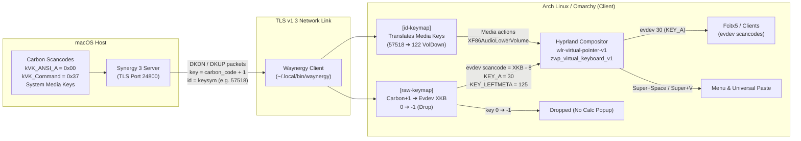

# Synergy / Waynergy on Wayland (Hyprland) with a macOS Server: Full Setup, Bug Diagnosis & Resolution Guide

## Executive Summary

When using **Synergy 3** (or Barrier / Deskflow) with a **macOS primary host (server)** and an **Arch Linux / Hyprland Wayland client**, several critical hurdles prevent out-of-the-box operation:
1. **Wayland Input Injection Freeze:** Official Synergy 3 / `synergy-core` relies on `xdg-desktop-portal`'s `RemoteDesktop` interface, which is not implemented by Hyprland. Falling back to X11 (`XTest`) freezes the cursor upon entering the Wayland screen.
2. **The "Missing 'A' Key" & Broken Shortcuts (`KEY_RESERVED` & Scancode Shift):** Connecting a Wayland client to a macOS Synergy server results in scrambled keys because macOS transmits raw Apple Carbon virtual scancodes. Existing community documentation suggests using a custom `mac` XKB keycodes file with `xkb_key_offset = 7`. While this appears to fix basic letter typing at first glance, it causes two critical failures:
   * **The 'A' key cannot type:** Waynergy converts internal XKB keycodes to Linux evdev scancodes by subtracting 8 (`key - 8`). With macOS 'A' mapped to XKB 8, Waynergy emits evdev scancode `0` (`KEY_RESERVED`), which the Linux kernel, Hyprland, and IMEs (like Fcitx5) discard as invalid.
   * **Compositor shortcuts fail:** Hyprland evaluates global shortcuts (such as `Super + Space` for the application launcher or `Super + V` for universal clipboard paste) against standard Linux evdev numbering, not the virtual keyboard's custom keymap. Keys like Space and V are emitted with shifted evdev codes (`KEY_N` and `KEY_8`), completely breaking desktop shortcuts.
3. **The Numeric Keypad (Numpad) Outputting Navigation Keys:** Apple external keyboards with a numpad emit distinct Carbon scancodes. Because Wayland lacks automatic NumLock synchronization from macOS, the numpad defaults to navigation actions (Page Up, Home, End, Arrows) instead of digits.
4. **The Media Keys & "Phantom Calculator Popup" (`Keycode 0`):** When macOS has standard function keys disabled (the default Mac mode where top-row keys control Volume, Brightness, and Media), macOS transmits Volume and Mute events without hardware scancodes (`key = 0`), relying instead on Synergy keysym IDs. Unmapped `key = 0` events are forwarded directly to Hyprland, where `modmask: 0` + `keycode: 0` triggers the default binding for `XF86Calculator`, repeatedly popping up the calculator application and causing keymap thrashing.

This document details the root causes and provides the complete, definitive solution: maintaining a standard Linux `evdev` keymap, using Waynergy's `[raw-keymap]` for full scancode translation and keycode-0 suppression, and utilizing `[id-keymap]` to translate macOS media keys into native Linux media actions.

---

## Architecture & Environment



* **Server:** macOS running Synergy 3 on port `24800` (TLS enabled).
* **Client Machine:** Arch Linux / Omarchy.
* **Compositor:** Hyprland (Wayland).
* **Synergy Client:** `waynergy` (compiled with `wlr` virtual input backend).

---

## Phase 1: Overcoming the Wayland Portal Cursor Freeze

### Problem
When Synergy 3's official client (`synergy-core`) connects to the macOS server on Hyprland, moving the mouse cursor onto the Linux screen immediately freezes input.

### Cause
Synergy 3's bundled `synergy-core` checks for Wayland and attempts to initialize the `org.freedesktop.portal.RemoteDesktop` D-Bus portal. Hyprland implements `xdg-desktop-portal-hyprland`, which provides screencasting (`ScreenCast`) and window sharing, but does **not** implement input emulation via `RemoteDesktop`. 

`synergy-core` then falls back to legacy X11 `XTest` synthetic events. Because Hyprland surfaces are native Wayland windows, `XTest` events are completely ignored by the compositor, freezing the cursor on the boundary.

### Solution
Deploy **`waynergy`**, an open-source Synergy/Barrier client built specifically for Wayland that interfaces directly with native compositor protocols:
* `zwlr_virtual_pointer_v1` for absolute and relative pointer motion and button clicks.
* `zwp_virtual_keyboard_v1` for virtual keyboard events and modifier state tracking.

---

## Phase 2: The Key Mismatch & The Flawed Offset Approach

### Problem
After getting Waynergy to connect and move the mouse, typing letters from the Mac keyboard produced incorrect characters:
* Pressing `Q` typed `4`.
* Pressing `W` typed `5`.
* Pressing `Delete / Backspace` typed `Z`.

### Cause
macOS hardware drivers emit Apple Carbon virtual scancodes:
* `kVK_ANSI_Q` is `0x0C` (12). Synergy sends this as `code + 1` = `13`.
* `kVK_ANSI_W` is `0x0D` (13). Synergy sends this as `code + 1` = `14`.
* `kVK_Delete` is `0x33` (51). Synergy sends this as `code + 1` = `52`.

On standard Linux PC keyboards, evdev scancode 13 is `KEY_4`, scancode 14 is `KEY_5`, and scancode 52 is `KEY_PERIOD`. Because Waynergy defaulted to a PC evdev keymap, raw macOS scancodes were treated as PC scancodes.

### The Initial (Flawed) Workaround
Waynergy's documentation suggests copying `doc/xkb/keycodes/mac` into `~/.config/xkb/keycodes/mac` and adding:
```ini
xkb_key_offset = 7
```
with an `xkb_keymap` that includes `"mac"` keycodes.

While letters like `Q`, `W`, and `E` began typing, this introduced two severe bugs.

---

## Phase 3: Root Cause Analysis of the 'A' Key & Shortcut Failures

### Bug 1: Why the Letter 'A' Could Never Type
1. In macOS Carbon headers (`Events.h`):
   ```c
   kVK_ANSI_A = 0x00
   ```
2. Synergy sends: `mac_code + 1` = `0 + 1 = 1`.
3. With `xkb_key_offset = 7`, Waynergy calculates:
   $$\text{XKB Keycode} = 1 + 7 = 8$$
   In the `mac` keycodes file, `<AC01>` (the 'A' key) was defined as:
   ```c
   <AC01> = 8;
   ```
4. In Waynergy's Wayland backend (`src/wl_input_wlr.c`):
   ```c
   static void key(struct wlInput *input, int key, int state)
   {
       ...
       zwp_virtual_keyboard_v1_key(wlr->keyboard, wlTS(input->wl_ctx), key - 8, state);
       ...
   }
   ```
   Waynergy subtracts 8 because the Wayland virtual keyboard protocol expects a **Linux evdev scancode** (`evdev = xkb - 8`).
5. For the 'A' key:
   $$\text{Emitted Scancode} = 8 - 8 = 0$$
6. In `<linux/input-event-codes.h>`:
   ```c
   #define KEY_RESERVED 0
   ```
   Scancode 0 is reserved. The Linux kernel, Hyprland's input pipeline, and Fcitx5 drop scancode 0 as invalid. The 'A' key was discarded on every keystroke.

### Bug 2: Why `Command + Space` and `Command + V` Failed
1. In Omarchy / Hyprland:
   * **`Super + Space`** is bound to the Omarchy application menu.
   * **`Super + V`** is bound to Universal Paste.
   * **`Super + C`** is bound to Universal Copy.
2. When the user pressed `Command + Space` on the Mac:
   * Command (`kVK_Command` = 55) was sent as `55 + 1 = 56`. With offset 7, this became 63 (`<LWIN>`), setting the `Mod4` (Super) modifier mask (`0x40`).
   * Space (`kVK_Space` = 49) was sent as `49 + 1 = 50`. With offset 7, it became 57 (`<SPCE>`).
   * Waynergy emitted evdev scancode:
     $$57 - 8 = 49 \quad (\text{Linux } \texttt{KEY\_N})$$
3. Hyprland evaluates compositor keybindings (`CKeybindManager::onKeyEvent`) by translating the incoming evdev scancode with its **own global layout** (`rules: l "us"`), **not** the virtual keyboard's custom layout:
   $$\text{Compositor Keycode} = \text{evdev } 49 + 8 = 57 \quad (\text{Letter 'N'})$$
4. Hyprland received **`Super + N`** instead of **`Super + Space`**, and **`Super + 8`** instead of **`Super + V`**. None of the shortcuts fired.

---

## Phase 4: Fixing General Typing via `[raw-keymap]`

### Solution Architecture
Instead of using shifted or custom XKB keycode definitions, the client should:
1. Retain the standard Linux `evdev` keymap (`evdev+aliases(qwerty)` / `pc+us+inet(evdev)`) across Waynergy, Hyprland, Fcitx5, and any local hardware keyboards.
2. Set `xkb_key_offset = 0`.
3. Use Waynergy's built-in `[raw-keymap]` section to map incoming Synergy keys (`mac_code + 1`) directly to standard Linux XKB keycodes (`evdev_scancode + 8`).

### Mathematical Translation
For any Apple Carbon virtual key:
$$\text{Synergy Packet Key} = \text{Carbon Code} + 1$$
$$\text{Target XKB Keycode} = \text{Linux evdev Scancode} + 8$$

When Waynergy processes the event:
* Waynergy updates its internal modifier state using `Target XKB Keycode`.
* Waynergy emits `Target XKB Keycode - 8 = Linux evdev Scancode` to Hyprland.
* 'A' emits evdev 30 (`KEY_A`) — no 0-scancode drop.
* Command emits evdev 125 (`KEY_LEFTMETA`).
* Space emits evdev 57 (`KEY_SPACE`).
* V emits evdev 47 (`KEY_V`).
* Hyprland evaluates `Mod4 + Space` and `Mod4 + V` perfectly.

---

## Phase 5: The Mac Numpad (Typing Numbers instead of Navigation Keys)

### Problem
Pressing keys on the numeric keypad of an extended Mac keyboard did not type numbers in Omarchy. Instead, pressing `1` did nothing or moved the cursor down/end, `6` navigated right, etc.

### Cause
On Mac keyboards, the numpad sends dedicated Carbon keycodes (`kVK_ANSI_Keypad0`..`9`). In Linux XKB, numpad keycodes produce numbers only when the `NumLock` modifier state is active. 

Because Mac keyboards do not have a physical `NumLock` toggle and macOS does not maintain a NumLock state flag, Synergy sends no NumLock modifier. As a result, Linux defaults the numpad keys to their secondary navigation functions (`KP_End`, `KP_Down`, `KP_Right`, `KP_Insert`, etc.).

### Solution
Map the numpad Carbon scancodes in `[raw-keymap]` directly to standard top-row number keycodes (`KEY_1` through `KEY_0`), decimal point (`KEY_DOT`), and Enter (`KEY_ENTER`):

```ini
# Mac Numpad -> Standard Digits & Operators
83 = 19   # KP 0 -> Digit 0 (XKB 19 = evdev 11)
84 = 10   # KP 1 -> Digit 1 (XKB 10 = evdev 2)
85 = 11   # KP 2 -> Digit 2 (XKB 11 = evdev 3)
86 = 12   # KP 3 -> Digit 3 (XKB 12 = evdev 4)
87 = 13   # KP 4 -> Digit 4 (XKB 13 = evdev 5)
88 = 14   # KP 5 -> Digit 5 (XKB 14 = evdev 6)
89 = 15   # KP 6 -> Digit 6 (XKB 15 = evdev 7)
90 = 16   # KP 7 -> Digit 7 (XKB 16 = evdev 8)
92 = 17   # KP 8 -> Digit 8 (XKB 17 = evdev 9)
93 = 18   # KP 9 -> Digit 9 (XKB 18 = evdev 10)
66 = 60   # KP . -> Period (XKB 60 = evdev 52)
77 = 36   # KP Enter -> Return (XKB 36 = evdev 28)
```

With this mapping in place, the keypad reliably inputs numbers regardless of compositor NumLock state.

---

## Phase 6: Function / Media Keys & The "Keycode 0 / Phantom Calculator" Bug

### Problem
When the macOS keyboard setting *"Use F1, F2, etc. keys as standard function keys"* is left **off** (the standard macOS default), pressing top-row media keys (such as Volume Down, Volume Up, or Mute) caused erratic behavior in Omarchy:
* Pressing Volume Down immediately launched the Calculator application (`omacalc`).
* A flood of key repeats and `Current keymap updated` compositor reloads were triggered.

### Root Cause Analysis
1. **NSSystemDefined Media Keys in Synergy:**
   On macOS, hardware media keys are intercepted at the OS kernel level as `NSSystemDefined` events rather than standard keyboard events. When forwarding them over Synergy, the macOS server sends packet messages with **`key = 0`** (no hardware scancode), but attaches a non-zero keysym ID:
   * Mute: `id = 57517` (`0xE0AD`), `key = 0`
   * Volume Down: `id = 57518` (`0xE0AE`), `key = 0`
   * Volume Up: `id = 57519` (`0xE0AF`), `key = 0`
   * Brightness Down: `id = 57528` (`0xE0B8`), `key = 146`
   * Brightness Up: `id = 57529` (`0xE0B9`), `key = 145`

2. **The Keycode 0 Fallthrough:**
   In Waynergy's `wlKey()` function:
   * It first checks `[id-keymap]`. If the ID is not found, it checks `[raw-keymap]`.
   * If `key = 0` is not in `[raw-keymap]`, Waynergy defaults to passing `key = 0` directly to `wlKeyRaw()`.
   * `wlKeyRaw()` invokes `zwp_virtual_keyboard_v1_key(..., key = 0, state = 1)` to Hyprland.

3. **Hyprland's `XF86Calculator` Trigger:**
   In Hyprland, default shortcuts include a binding for `XF86Calculator`:
   ```text
   bindd, modmask: 0, key: XF86Calculator, keycode: 0, dispatcher: __lua (Calculator)
   ```
   Because `XF86Calculator` resolves with `modmask: 0` and `keycode: 0`, any raw keycode-0 event received with no modifiers matches this binding. Hyprland immediately executes `omacalc`.

4. **Dropping Keys in Waynergy:**
   In Waynergy's internal logic:
   ```c
   if (key == -1) {
       logDbg("Dropping key mapped to -1");
       return;
   }
   ```
   Mapping any key to `-1` causes Waynergy to silently discard the event without passing it to Wayland.

### Solution
1. **Suppress Unmapped Keycode 0:**
   In `[raw-keymap]`, map `0 = -1`. Any unknown or unmapped keycode 0 is cleanly dropped, preventing Hyprland from launching the calculator.
2. **Translate Media Keys via `[id-keymap]`:**
   Add an `[id-keymap]` section to map the Synergy media IDs directly to Linux evdev XKB keycodes:
   * `57517 = 121` (`XF86AudioMute`)
   * `57518 = 122` (`XF86AudioLowerVolume`)
   * `57519 = 123` (`XF86AudioRaiseVolume`)
   * `57528 = 232` (`XF86MonBrightnessDown`)
   * `57529 = 233` (`XF86MonBrightnessUp`)
3. **Map Brightness Raw Scancodes in `[raw-keymap]`:**
   * `145 = 233` (Brightness Up)
   * `146 = 232` (Brightness Down)

Now, Volume Down, Volume Up, Mute, and Brightness directly control Omarchy's audio and screen brightness without needing any macOS settings changes, and without triggering phantom applications.

---

## Configuration Files

### 1. `~/.config/waynergy/config.ini`

The address `192.0.2.10` and client name `wayland-client` below are placeholders. Replace them with your server address and the client name configured on your server.

```ini
host = 192.0.2.10
port = 24800
name = wayland-client
backend = wlr
xkb_key_offset = 0

[tls]
enable = true
tofu = true

[log]
level = debug

[id-keymap]
57517 = 121
57518 = 122
57519 = 123
57528 = 232
57529 = 233

[raw-keymap]
0 = -1
offset_on_explicit = false
145 = 233
146 = 232
1 = 38
2 = 39
3 = 40
4 = 41
5 = 43
6 = 42
7 = 52
8 = 53
9 = 54
10 = 55
12 = 56
13 = 24
14 = 25
15 = 26
16 = 27
17 = 29
18 = 28
19 = 10
20 = 11
21 = 12
22 = 13
23 = 15
24 = 14
25 = 21
26 = 18
27 = 16
28 = 20
29 = 17
30 = 19
31 = 35
32 = 32
33 = 30
34 = 34
35 = 31
36 = 33
37 = 36
38 = 46
39 = 44
40 = 48
41 = 45
42 = 47
43 = 51
44 = 59
45 = 61
46 = 57
47 = 58
48 = 60
49 = 23
50 = 65
51 = 49
52 = 22
54 = 9
55 = 134
56 = 133
57 = 50
58 = 66
59 = 64
60 = 37
61 = 62
62 = 108
63 = 105
66 = 60
68 = 63
70 = 86
72 = 77
76 = 106
77 = 36
79 = 82
83 = 19
84 = 10
85 = 11
86 = 12
87 = 13
88 = 14
89 = 15
90 = 16
92 = 17
93 = 18
97 = 71
98 = 72
99 = 173
100 = 69
101 = 172
102 = 171
104 = 122
106 = 107
108 = 78
110 = 121
111 = 135
112 = 123
114 = 127
115 = 118
116 = 110
117 = 112
118 = 119
119 = 133
120 = 115
121 = 233
122 = 117
123 = 232
124 = 113
125 = 114
126 = 116
127 = 111
```

### 2. `~/.config/waynergy/xkb_keymap`

```c
xkb_keymap {
        xkb_keycodes  { include "evdev+aliases(qwerty)"     };
        xkb_types     { include "complete"    };
        xkb_compat    { include "complete"    };
        xkb_symbols   { include "pc+us+inet(evdev)"     };
        xkb_geometry  { include "pc(pc105)"   };
};
```

### 3. `~/.config/systemd/user/waynergy.service`

```ini
[Unit]
Description=Waynergy - Synergy client for Wayland (Hyprland)
After=graphical-session.target
PartOf=graphical-session.target

[Service]
ExecStart=%h/.local/bin/waynergy -L debug
Restart=always
RestartSec=3

[Install]
WantedBy=graphical-session.target
```

> [!TIP]
> If you need to diagnose incoming packet IDs from Synergy for new keys, run `waynergy` with `-L debugsyn` to log `[DEBUGSYN] DKDN: id <id>, mod <mod>, key <key>` lines directly in `journalctl --user -u waynergy`.

---

## Key Mapping Reference Tables (macOS ➔ Linux Evdev)

### 1. Standard Alpha, Navigation & Modifiers

| Mac Key | Carbon Code | Synergy Key (`+1`) | Evdev Sym | Linux evdev (`xkb-8`) | Target XKB Keycode |
| :--- | :--- | :--- | :--- | :--- | :--- |
| **A** | `0x00` (0) | **1** | `<AC01>` | 30 (`KEY_A`) | **38** |
| **S** | `0x01` (1) | **2** | `<AC02>` | 31 (`KEY_S`) | **39** |
| **D** | `0x02` (2) | **3** | `<AC03>` | 32 (`KEY_D`) | **40** |
| **F** | `0x03` (3) | **4** | `<AC04>` | 33 (`KEY_F`) | **41** |
| **H** | `0x04` (4) | **5** | `<AC06>` | 35 (`KEY_H`) | **43** |
| **G** | `0x05` (5) | **6** | `<AC05>` | 34 (`KEY_G`) | **42** |
| **Z** | `0x06` (6) | **7** | `<AB01>` | 44 (`KEY_Z`) | **52** |
| **X** | `0x07` (7) | **8** | `<AB02>` | 45 (`KEY_X`) | **53** |
| **C** | `0x08` (8) | **9** | `<AB03>` | 46 (`KEY_C`) | **54** |
| **V** | `0x09` (9) | **10** | `<AB04>` | 47 (`KEY_V`) | **55** |
| **B** | `0x0B` (11) | **12** | `<AB05>` | 48 (`KEY_B`) | **56** |
| **Q** | `0x0C` (12) | **13** | `<AD01>` | 16 (`KEY_Q`) | **24** |
| **W** | `0x0D` (13) | **14** | `<AD02>` | 17 (`KEY_W`) | **25** |
| **E** | `0x0E` (14) | **15** | `<AD03>` | 18 (`KEY_E`) | **26** |
| **R** | `0x0F` (15) | **16** | `<AD04>` | 19 (`KEY_R`) | **27** |
| **Y** | `0x10` (16) | **17** | `<AD06>` | 21 (`KEY_Y`) | **29** |
| **T** | `0x11` (17) | **18** | `<AD05>` | 20 (`KEY_T`) | **28** |
| **Space** | `0x31` (49) | **50** | `<SPCE>` | 57 (`KEY_SPACE`) | **65** |
| **Delete** | `0x33` (51) | **52** | `<BKSP>` | 14 (`KEY_BACKSPACE`) | **22** |
| **Escape** | `0x35` (53) | **54** | `<ESC>` | 1 (`KEY_ESC`) | **9** |
| **Right Cmd** | `0x36` (54) | **55** | `<RWIN>` | 126 (`KEY_RIGHTMETA`) | **134** |
| **Left Cmd** | `0x37` (55) | **56** | `<LWIN>` | 125 (`KEY_LEFTMETA`) | **133** |
| **Left Shift** | `0x38` (56) | **57** | `<LFSH>` | 42 (`KEY_LEFTSHIFT`) | **50** |
| **Caps Lock** | `0x39` (57) | **58** | `<CAPS>` | 58 (`KEY_CAPSLOCK`) | **66** |
| **Left Option**| `0x3A` (58) | **59** | `<LALT>` | 56 (`KEY_LEFTALT`) | **64** |
| **Left Ctrl** | `0x3B` (59) | **60** | `<LCTL>` | 29 (`KEY_LEFTCTRL`) | **37** |
| **Right Shift**| `0x3C` (60) | **61** | `<RTSH>` | 54 (`KEY_RIGHTSHIFT`) | **62** |
| **Right Option**|`0x3D` (61) | **62** | `<RALT>` | 100 (`KEY_RIGHTALT`)| **108** |
| **Right Ctrl** | `0x3E` (62) | **63** | `<RCTL>` | 97 (`KEY_RIGHTCTRL`) | **105** |

### 2. Numeric Keypad (Numpad)

| Mac Key | Carbon Code | Synergy Key (`+1`) | Evdev Sym | Mapped Linux Evdev | Target XKB Keycode |
| :--- | :--- | :--- | :--- | :--- | :--- |
| **KP 0** | `0x52` (82) | **83** | `<AE10>` | 11 (`KEY_0`) | **19** |
| **KP 1** | `0x53` (83) | **84** | `<AE01>` | 2 (`KEY_1`) | **10** |
| **KP 2** | `0x54` (84) | **85** | `<AE02>` | 3 (`KEY_2`) | **11** |
| **KP 3** | `0x55` (85) | **86** | `<AE03>` | 4 (`KEY_3`) | **12** |
| **KP 4** | `0x56` (86) | **87** | `<AE04>` | 5 (`KEY_4`) | **13** |
| **KP 5** | `0x57` (87) | **88** | `<AE05>` | 6 (`KEY_5`) | **14** |
| **KP 6** | `0x58` (88) | **89** | `<AE06>` | 7 (`KEY_6`) | **15** |
| **KP 7** | `0x59` (89) | **90** | `<AE07>` | 8 (`KEY_7`) | **16** |
| **KP 8** | `0x5B` (91) | **92** | `<AE08>` | 9 (`KEY_8`) | **17** |
| **KP 9** | `0x5C` (92) | **93** | `<AE09>` | 10 (`KEY_9`) | **18** |
| **KP .** | `0x41` (65) | **66** | `<AB09>` | 52 (`KEY_DOT`) | **60** |
| **KP Enter**| `0x4C` (76) | **77** | `<RTRN>` | 28 (`KEY_ENTER`) | **36** |

### 3. Media & Audio Controls (`[id-keymap]`)

| Mac Function | Synergy Packet ID | Synergy Raw Key | Linux evdev Target | Target XKB Keycode | Action in Omarchy / Hyprland |
| :--- | :--- | :--- | :--- | :--- | :--- |
| **Mute** | `57517` | `0` | 113 (`KEY_MUTE`) | **121** | `XF86AudioMute` |
| **Volume Down** | `57518` | `0` | 114 (`KEY_VOLUMEDOWN`) | **122** | `XF86AudioLowerVolume` |
| **Volume Up** | `57519` | `0` | 115 (`KEY_VOLUMEUP`) | **123** | `XF86AudioRaiseVolume` |
| **Brightness Down** | `57528` | `146` | 224 (`KEY_BRIGHTNESSDOWN`)| **232** | `XF86MonBrightnessDown` |
| **Brightness Up** | `57529` | `145` | 225 (`KEY_BRIGHTNESSUP`) | **233** | `XF86MonBrightnessUp` |

---

## Recommendations for Upstream (`r-c-f/waynergy`)

1. **Deprecate or Clarify `doc/xkb/keycodes/mac`:**
   * The documentation in `doc/xkb/keycodes/mac` that advises `xkb_key_offset = 7` creates an inescapable conflict under Wayland wlroots compositors. Because `key - 8` is hardcoded in `wl_input_wlr.c`, keycode 8 inevitably produces evdev scancode 0 (`KEY_RESERVED`), which breaks the 'A' key on macOS servers.
2. **Promote the `[raw-keymap]` Approach for macOS Hosts:**
   * Provide the explicit `[raw-keymap]` configuration as the recommended template in `doc/config-example/config.ini.mac`.
   * This preserves standard evdev scancode alignment, ensures compositor keybinds work as expected, and avoids tainting the Wayland seat keymap.
3. **Drop Unmapped Keycode 0 by Default:**
   * Incoming Synergy packets with `key = 0` should not default to emitting evdev scancode 0 when unmapped. Setting `0 = -1` or ignoring scancode 0 inside `wlKey()` prevents compositors from triggering bogus fallback keybinds (such as `XF86Calculator`).
4. **Document `[id-keymap]` for macOS Media Keys:**
   * Document how `[id-keymap]` allows translating keysym-only events (like macOS `NSSystemDefined` media controls) into native Wayland media keycodes without requiring third-party remappers.
5. **Include Right-Hand Modifiers:**
   * Ensure `RightCommand` (55), `RightShift` (61), `RightOption` (62), and `RightControl` (63) are included in all macOS example layouts.
