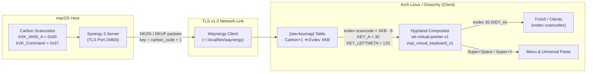

# Synergy / Waynergy on Wayland (Hyprland) with a macOS Server: Full Setup, Bug Diagnosis & Resolution Guide

## Executive Summary

When using **Synergy 3** (or Barrier / Deskflow) with a **macOS primary host (server)** and an **Arch Linux / Hyprland Wayland client**, two critical hurdles prevent out-of-the-box operation:
1. **Wayland Input Injection Freeze:** Official Synergy 3 / `synergy-core` relies on `xdg-desktop-portal`'s `RemoteDesktop` interface, which is not implemented by Hyprland. Falling back to X11 (`XTest`) freezes the cursor upon entering the Wayland screen.
2. **The "Missing 'A' Key" & Broken Shortcuts (`KEY_RESERVED` & Scancode Shift):** Connecting a Wayland client to a macOS Synergy server results in scrambled keys because macOS transmits raw Apple Carbon virtual scancodes. Existing community documentation suggests using a custom `mac` XKB keycodes file with `xkb_key_offset = 7`. While this appears to fix basic letter typing at first glance, it causes two critical failures:
   * **The 'A' key cannot type:** Waynergy converts internal XKB keycodes to Linux evdev scancodes by subtracting 8 (`key - 8`). With macOS 'A' mapped to XKB 8, Waynergy emits evdev scancode `0` (`KEY_RESERVED`), which the Linux kernel, Hyprland, and IMEs (like Fcitx5) discard as invalid.
   * **Compositor shortcuts fail:** Hyprland evaluates global shortcuts (such as `Super + Space` for the application launcher or `Super + V` for universal clipboard paste) against standard Linux evdev numbering, not the virtual keyboard's custom keymap. Keys like Space and V are emitted with shifted evdev codes (`KEY_N` and `KEY_8`), completely breaking desktop shortcuts.

This document details the root causes and provides the definitive solution: keeping the virtual keyboard on the standard Linux `evdev` keymap and using Waynergy's `[raw-keymap]` section to translate all 104 macOS Carbon scancodes directly into standard Linux evdev keycodes.

---

## Architecture & Environment



* **Server:** macOS running Synergy 3 on port `24800` (TLS enabled).
* **Client Machine:** Arch Linux / Omarchy.
* **Compositor:** Hyprland (Wayland).
* **Synergy Client:** `waynergy` (compiled with `wlr` virtual input backend).

---

## Phase 1: Overcoming the Wayland Portal Cursor Freeze

### Problem
When Synergy 3's official client (`synergy-core`) connects to the macOS server on Hyprland, moving the mouse cursor onto the Linux screen immediately freezes input.

### Cause
Synergy 3's bundled `synergy-core` checks for Wayland and attempts to initialize the `org.freedesktop.portal.RemoteDesktop` D-Bus portal. Hyprland implements `xdg-desktop-portal-hyprland`, which provides screencasting (`ScreenCast`) and window sharing, but does **not** implement input emulation via `RemoteDesktop`. 

`synergy-core` then falls back to legacy X11 `XTest` synthetic events. Because Hyprland surfaces are native Wayland windows, `XTest` events are completely ignored by the compositor, freezing the cursor on the boundary.

### Solution
Deploy **`waynergy`**, an open-source Synergy/Barrier client built specifically for Wayland that interfaces directly with native compositor protocols:
* `zwlr_virtual_pointer_v1` for absolute and relative pointer motion and button clicks.
* `zwp_virtual_keyboard_v1` for virtual keyboard events and modifier state tracking.

---

## Phase 2: The Key Mismatch & The Flawed Offset Approach

### Problem
After getting Waynergy to connect and move the mouse, typing letters from the Mac keyboard produced incorrect characters:
* Pressing `Q` typed `4`.
* Pressing `W` typed `5`.
* Pressing `Delete / Backspace` typed `Z`.

### Cause
macOS hardware drivers emit Apple Carbon virtual scancodes:
* `kVK_ANSI_Q` is `0x0C` (12). Synergy sends this as `code + 1` = `13`.
* `kVK_ANSI_W` is `0x0D` (13). Synergy sends this as `code + 1` = `14`.
* `kVK_Delete` is `0x33` (51). Synergy sends this as `code + 1` = `52`.

On standard Linux PC keyboards, evdev scancode 13 is `KEY_4`, scancode 14 is `KEY_5`, and scancode 52 is `KEY_PERIOD`. Because Waynergy defaulted to a PC evdev keymap, raw macOS scancodes were treated as PC scancodes.

### The Initial (Flawed) Workaround
Waynergy's documentation suggests copying `doc/xkb/keycodes/mac` into `~/.config/xkb/keycodes/mac` and adding:
```ini
xkb_key_offset = 7
```
with an `xkb_keymap` that includes `"mac"` keycodes.

While letters like `Q`, `W`, and `E` began typing, this introduced two severe bugs.

---

## Phase 3: Root Cause Analysis of the 'A' Key & Shortcut Failures

### Bug 1: Why the Letter 'A' Could Never Type
1. In macOS Carbon headers (`Events.h`):
   ```c
   kVK_ANSI_A = 0x00
   ```
2. Synergy sends: `mac_code + 1` = `0 + 1 = 1`.
3. With `xkb_key_offset = 7`, Waynergy calculates:
   $$\text{XKB Keycode} = 1 + 7 = 8$$
   In the `mac` keycodes file, `<AC01>` (the 'A' key) was defined as:
   ```c
   <AC01> = 8;
   ```
4. In Waynergy's Wayland backend (`src/wl_input_wlr.c`):
   ```c
   static void key(struct wlInput *input, int key, int state)
   {
       ...
       zwp_virtual_keyboard_v1_key(wlr->keyboard, wlTS(input->wl_ctx), key - 8, state);
       ...
   }
   ```
   Waynergy subtracts 8 because the Wayland virtual keyboard protocol expects a **Linux evdev scancode** (`evdev = xkb - 8`).
5. For the 'A' key:
   $$\text{Emitted Scancode} = 8 - 8 = 0$$
6. In `<linux/input-event-codes.h>`:
   ```c
   #define KEY_RESERVED 0
   ```
   Scancode 0 is reserved. The Linux kernel, Hyprland's input pipeline, and Fcitx5 drop scancode 0 as invalid. The 'A' key was discarded on every keystroke.

### Bug 2: Why `Command + Space` and `Command + V` Failed
1. In Omarchy / Hyprland:
   * **`Super + Space`** is bound to the Omarchy application menu.
   * **`Super + V`** is bound to Universal Paste.
   * **`Super + C`** is bound to Universal Copy.
2. When the user pressed `Command + Space` on the Mac:
   * Command (`kVK_Command` = 55) was sent as `55 + 1 = 56`. With offset 7, this became 63 (`<LWIN>`), setting the `Mod4` (Super) modifier mask (`0x40`).
   * Space (`kVK_Space` = 49) was sent as `49 + 1 = 50`. With offset 7, it became 57 (`<SPCE>`).
   * Waynergy emitted evdev scancode:
     $$57 - 8 = 49 \quad (\text{Linux } \texttt{KEY\_N})$$
3. Hyprland evaluates compositor keybindings (`CKeybindManager::onKeyEvent`) by translating the incoming evdev scancode with its **own global layout** (`rules: l "us"`), **not** the virtual keyboard's custom layout:
   $$\text{Compositor Keycode} = \text{evdev } 49 + 8 = 57 \quad (\text{Letter 'N'})$$
4. Hyprland received **`Super + N`** instead of **`Super + Space`**, and **`Super + 8`** instead of **`Super + V`**. None of the shortcuts fired.

---

## Phase 4: The Definitive Fix

### Solution Architecture
Instead of using shifted or custom XKB keycode definitions, the client should:
1. Retain the standard Linux `evdev` keymap (`evdev+aliases(qwerty)` / `pc+us+inet(evdev)`) across Waynergy, Hyprland, Fcitx5, and any local hardware keyboards.
2. Set `xkb_key_offset = 0`.
3. Use Waynergy's built-in `[raw-keymap]` section to map incoming Synergy keys (`mac_code + 1`) directly to standard Linux XKB keycodes (`evdev_scancode + 8`).

### Mathematical Translation
For any Apple Carbon virtual key:
$$\text{Synergy Packet Key} = \text{Carbon Code} + 1$$
$$\text{Target XKB Keycode} = \text{Linux evdev Scancode} + 8$$

When Waynergy processes the event:
* Waynergy updates its internal modifier state using `Target XKB Keycode`.
* Waynergy emits `Target XKB Keycode - 8 = Linux evdev Scancode` to Hyprland.
* 'A' emits evdev 30 (`KEY_A`) — no 0-scancode drop.
* Command emits evdev 125 (`KEY_LEFTMETA`).
* Space emits evdev 57 (`KEY_SPACE`).
* V emits evdev 47 (`KEY_V`).
* Hyprland evaluates `Mod4 + Space` and `Mod4 + V` perfectly.

---

## Configuration Files

### 1. `~/.config/waynergy/config.ini`

The address `192.0.2.10` and client name `wayland-client` below are examples. Replace them with your server address and the client name configured on the server.

```ini
host = 192.0.2.10
port = 24800
name = wayland-client
backend = wlr
xkb_key_offset = 0

[tls]
enable = true
tofu = true

[log]
level = debug

[raw-keymap]
offset_on_explicit = false
1 = 38
2 = 39
3 = 40
4 = 41
5 = 43
6 = 42
7 = 52
8 = 53
9 = 54
10 = 55
12 = 56
13 = 24
14 = 25
15 = 26
16 = 27
17 = 29
18 = 28
19 = 10
20 = 11
21 = 12
22 = 13
23 = 15
24 = 14
25 = 21
26 = 18
27 = 16
28 = 20
29 = 17
30 = 19
31 = 35
32 = 32
33 = 30
34 = 34
35 = 31
36 = 33
37 = 36
38 = 46
39 = 44
40 = 48
41 = 45
42 = 47
43 = 51
44 = 59
45 = 61
46 = 57
47 = 58
48 = 60
49 = 23
50 = 65
51 = 49
52 = 22
54 = 9
55 = 134
56 = 133
57 = 50
58 = 66
59 = 64
60 = 37
61 = 62
62 = 108
63 = 105
66 = 91
68 = 63
70 = 86
72 = 77
76 = 106
77 = 104
79 = 82
83 = 90
84 = 87
85 = 88
86 = 89
87 = 83
88 = 84
89 = 85
90 = 79
92 = 80
93 = 81
97 = 71
98 = 72
99 = 73
100 = 69
101 = 74
102 = 75
104 = 95
106 = 107
108 = 78
110 = 76
111 = 135
112 = 96
114 = 127
115 = 118
116 = 110
117 = 112
118 = 119
119 = 70
120 = 115
121 = 68
122 = 117
123 = 67
124 = 113
125 = 114
126 = 116
127 = 111
```

### 2. `~/.config/waynergy/xkb_keymap`

```c
xkb_keymap {
        xkb_keycodes  { include "evdev+aliases(qwerty)"     };
        xkb_types     { include "complete"    };
        xkb_compat    { include "complete"    };
        xkb_symbols   { include "pc+us+inet(evdev)"     };
        xkb_geometry  { include "pc(pc105)"   };
};
```

### 3. `~/.config/systemd/user/waynergy.service`

```ini
[Unit]
Description=Waynergy - Synergy client for Wayland (Hyprland)
After=graphical-session.target
PartOf=graphical-session.target

[Service]
ExecStart=%h/.local/bin/waynergy -L debug
Restart=on-failure
RestartSec=3

[Install]
WantedBy=graphical-session.target
```

---

## Key Mapping Reference Table (macOS ➔ Linux Evdev)

| Mac Key | Carbon Code | Synergy Key (`+1`) | Evdev Sym | Linux evdev (`xkb-8`) | Target XKB Keycode |
| :--- | :--- | :--- | :--- | :--- | :--- |
| **A** | `0x00` (0) | **1** | `<AC01>` | 30 (`KEY_A`) | **38** |
| **S** | `0x01` (1) | **2** | `<AC02>` | 31 (`KEY_S`) | **39** |
| **D** | `0x02` (2) | **3** | `<AC03>` | 32 (`KEY_D`) | **40** |
| **F** | `0x03` (3) | **4** | `<AC04>` | 33 (`KEY_F`) | **41** |
| **H** | `0x04` (4) | **5** | `<AC06>` | 35 (`KEY_H`) | **43** |
| **G** | `0x05` (5) | **6** | `<AC05>` | 34 (`KEY_G`) | **42** |
| **Z** | `0x06` (6) | **7** | `<AB01>` | 44 (`KEY_Z`) | **52** |
| **X** | `0x07` (7) | **8** | `<AB02>` | 45 (`KEY_X`) | **53** |
| **C** | `0x08` (8) | **9** | `<AB03>` | 46 (`KEY_C`) | **54** |
| **V** | `0x09` (9) | **10** | `<AB04>` | 47 (`KEY_V`) | **55** |
| **B** | `0x0B` (11) | **12** | `<AB05>` | 48 (`KEY_B`) | **56** |
| **Q** | `0x0C` (12) | **13** | `<AD01>` | 16 (`KEY_Q`) | **24** |
| **W** | `0x0D` (13) | **14** | `<AD02>` | 17 (`KEY_W`) | **25** |
| **E** | `0x0E` (14) | **15** | `<AD03>` | 18 (`KEY_E`) | **26** |
| **R** | `0x0F` (15) | **16** | `<AD04>` | 19 (`KEY_R`) | **27** |
| **Y** | `0x10` (16) | **17** | `<AD06>` | 21 (`KEY_Y`) | **29** |
| **T** | `0x11` (17) | **18** | `<AD05>` | 20 (`KEY_T`) | **28** |
| **Space** | `0x31` (49) | **50** | `<SPCE>` | 57 (`KEY_SPACE`) | **65** |
| **Delete** | `0x33` (51) | **52** | `<BKSP>` | 14 (`KEY_BACKSPACE`) | **22** |
| **Escape** | `0x35` (53) | **54** | `<ESC>` | 1 (`KEY_ESC`) | **9** |
| **Right Cmd** | `0x36` (54) | **55** | `<RWIN>` | 126 (`KEY_RIGHTMETA`) | **134** |
| **Left Cmd** | `0x37` (55) | **56** | `<LWIN>` | 125 (`KEY_LEFTMETA`) | **133** |
| **Left Shift** | `0x38` (56) | **57** | `<LFSH>` | 42 (`KEY_LEFTSHIFT`) | **50** |
| **Caps Lock** | `0x39` (57) | **58** | `<CAPS>` | 58 (`KEY_CAPSLOCK`) | **66** |
| **Left Option**| `0x3A` (58) | **59** | `<LALT>` | 56 (`KEY_LEFTALT`) | **64** |
| **Left Ctrl** | `0x3B` (59) | **60** | `<LCTL>` | 29 (`KEY_LEFTCTRL`) | **37** |
| **Right Shift**| `0x3C` (60) | **61** | `<RTSH>` | 54 (`KEY_RIGHTSHIFT`) | **62** |
| **Right Option**|`0x3D` (61) | **62** | `<RALT>` | 100 (`KEY_RIGHTALT`)| **108** |
| **Right Ctrl** | `0x3E` (62) | **63** | `<RCTL>` | 97 (`KEY_RIGHTCTRL`) | **105** |

---

## Recommendations for Upstream (`r-c-f/waynergy`)

1. **Deprecate or Clarify `doc/xkb/keycodes/mac`:**
   * The documentation in `doc/xkb/keycodes/mac` that advises `xkb_key_offset = 7` creates an inescapable conflict under Wayland wlroots compositors. Because `key - 8` is hardcoded in `wl_input_wlr.c`, keycode 8 inevitably produces evdev scancode 0 (`KEY_RESERVED`), which breaks the 'A' key on macOS servers.
2. **Promote the `[raw-keymap]` Approach for macOS Hosts:**
   * Provide the 104-key explicit `[raw-keymap]` configuration as the recommended template in `doc/config-example/config.ini.mac`.
   * This preserves standard evdev scancode alignment, ensures compositor keybinds work as expected, and avoids tainting the Wayland seat keymap.
3. **Include Right-Hand Modifiers:**
   * Ensure `RightCommand` (55), `RightShift` (61), `RightOption` (62), and `RightControl` (63) are included in all macOS example layouts.
